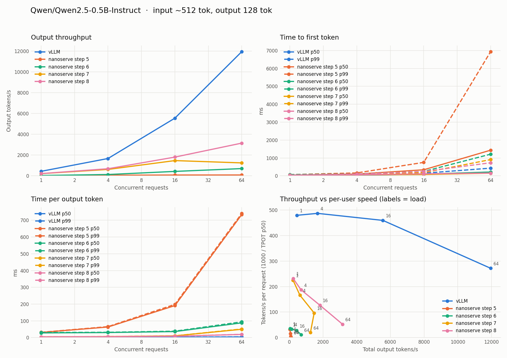

# nanoserve: an LLM inference engine built from scratch, benchmarked against vLLM

[](https://github.com/Kunal-Chandarana/vLLMLearning/actions/workflows/ci.yml)

**nanoserve** is a small LLM serving engine written from scratch in PyTorch to
understand how vLLM works inside. It has the same core design: a model that
takes flat token batches, a paged KV cache, a continuous-batching scheduler
with chunked prefill and preemption, and an OpenAI-compatible streaming server.
On top of that come the execution-level optimizations that make vLLM fast:
batched paged attention, CUDA graphs, GPU-side sampling, and a custom Triton
paged-attention kernel.

Each optimization was chosen by profiling and then measured against `vllm
serve` on the same GPU. On an RTX 4090 with Qwen2.5-0.5B, the throughput gap
to vLLM went from **67× to 3.1×** at 16 concurrent requests, and from **136× to
3.8×** at 64.



## Results: measure, profile, fix, repeat

Same model (Qwen2.5-0.5B-Instruct, bf16), same workload (512-token prompts,
128-token outputs), same RTX 4090, `vllm serve` 0.32 as the reference. Output
throughput, nanoserve vs vLLM:

| Step | What the profile showed | Fix | Conc. 1 | Conc. 16 | Conc. 64 |
|---|---|---|---|---|---|
| 5 | Baseline: algorithms right, execution slow | — | 13× behind | 67× behind | 136× behind |
| 6 | Attention ran a Python loop per sequence: ~11,000 kernel launches per step, GPU idle 86% | [Batched paged attention](nanoserve/paged_attention.py): one gather + one SDPA call per layer | 12× | 12× | 16× |
| 7 | ~1,470 launches per step from Python for 5.7 ms of GPU work; GPU still idle 83% | [CUDA graphs](nanoserve/cuda_graphs.py) for decode steps | **2.1×** | **4.0×** | **10.6×** |
| 8 | 81% of GPU time at batch 64 was one memcpy: the full logits (39 MB) going to the CPU for sampling | [GPU-side sampling](nanoserve/engine.py); token ids only come back | **2.0×** | **3.1×** | **3.8×** |

Decode step time across steps:

| Batch | Step 6 (eager) | Step 7 (CUDA graphs) | Step 8 (GPU sampling) |
|---|---|---|---|
| 1 | 24.3 ms | 4.6 ms | 4.4 ms |
| 16 | 26.8 ms | 9.3 ms | 5.7 ms |
| 64 | 61.0 ms | 51.7 ms | 7.4 ms |

Step 8 also added a [Triton paged-attention kernel](nanoserve/triton_attention.py)
that reads K/V through the block table instead of gathering. It's correct and
slightly faster at batch 64, but slower at small batches without split-K, so
it's opt-in. Attention turned out not to be the bottleneck at these context
lengths; reading the profile's breakdown is what found the real one.

The full write-up, with profiles and raw data for each step, is in
[`nanoserve/README.md`](nanoserve/README.md). The results are in
[`benchmarks/results/`](benchmarks/results/).

## What's inside

| Component | What it does | Code |
|---|---|---|
| Model | Qwen2 from scratch (GQA, RoPE, SwiGLU, RMSNorm), loading HF safetensors, outputs matched against `transformers` | [`model.py`](nanoserve/model.py) |
| Paged KV cache | Fixed-size blocks, block allocator, per-sequence block tables; batched attention with GQA folded in, so K/V are never copied per head | [`paged_attention.py`](nanoserve/paged_attention.py) |
| Scheduler | Continuous batching in vLLM V1's order: running requests first, then waiting ones; token budget, chunked prefill, preemption with recompute | [`engine.py`](nanoserve/engine.py) |
| CUDA graphs | Decode steps captured per (batch, context) bucket and replayed with one launch; one packed host-to-device copy per step; padded rows go to a scratch block | [`cuda_graphs.py`](nanoserve/cuda_graphs.py) |
| Triton kernel | Paged decode attention: one program per (sequence, KV head), online softmax over the block table, GQA group read once per block | [`triton_attention.py`](nanoserve/triton_attention.py) |
| Sampling | On the GPU: batched argmax / multinomial, only token ids return; seeded requests stay reproducible | [`engine.py`](nanoserve/engine.py) |
| Server | OpenAI-compatible `/v1/completions` and `/v1/chat/completions`, SSE streaming, abort on disconnect, incremental detokenization, `/metrics` | [`server.py`](nanoserve/server.py) |
| Profiler | `torch.profiler` over decode steps: step time, GPU busy time, kernel launches | [`profile_step.py`](nanoserve/profile_step.py) |
| Benchmark | Load generator for any OpenAI-compatible server: TTFT, TPOT, ITL, E2E and goodput at p50–p99, with plots | [`benchmarks/`](benchmarks/README.md) |
| GPU comparison | One script: installs vLLM, benchmarks both engines on the same GPU, profiles, writes a side-by-side table | [`compare_engines.sh`](benchmarks/compare_engines.sh) |

## Engineering notes

A few things that were harder or more interesting than expected:

- **Correctness first.** Every optimization must leave greedy output unchanged:
  the tests compare against Hugging Face `transformers` and against
  one-request-at-a-time generation, under preemption, chunked prefill, requests
  arriving mid-flight and padded graph batches.
- **Decode is memory-bound, prefill is compute-bound.** That's why batching
  helps decode so much on a GPU. Reading the weights once serves the whole
  batch, so vLLM's time per token barely moves from 1 to 16 concurrent
  requests. nanoserve reached the same flat shape only after step 6.
- **A CUDA graph bug that only appeared on the GPU.** A graph worked once and
  then hit an index-out-of-bounds assert on the second replay. The graph read
  tensors that only its warmup closure kept alive; once they were freed, the
  caching allocator reused their memory for the next eager op. Anything a
  captured graph reads has to live as long as the graph does.
- **Padding without NaNs.** Graph batches are padded to fixed sizes. Padded
  rows write K/V to a scratch block the allocator never hands out, and attend
  to exactly one key, so softmax never sees an all-masked row.
- **A wrong guess, corrected by the profile.** After step 7 the remaining GPU
  time at batch 64 looked like the padded KV gather, so step 8 wrote a Triton
  kernel to remove it. The kernel worked and changed nothing. The profile's
  top row was a 39 MB device-to-host copy of the logits every step: Qwen's
  152k-token vocabulary times 64 sequences. Sampling on the GPU cut the step
  from 51.7 ms to 7.4 ms. The write-up keeps the wrong claim, struck through,
  next to the correction.

## Run it

On a laptop (CPU), with no GPU needed:

```bash
pip install torch transformers safetensors huggingface_hub fastapi uvicorn aiohttp matplotlib pytest
pytest -q tests                                          # unit and correctness tests
python -m nanoserve.generate --chat --prompt "What is a KV cache?"
python -m nanoserve.server --model Qwen/Qwen2.5-0.5B-Instruct --port 8000
```

The head-to-head with vLLM, on any NVIDIA GPU with 16 GB+ and bf16 support
(about 30 minutes):

```bash
git clone https://github.com/Kunal-Chandarana/vLLMLearning.git && cd vLLMLearning
bash benchmarks/compare_engines.sh   # results, plots and logs in benchmarks/results/gpu/
```

## Next

- **The serving loop.** At batch 64 a decode step takes 7.4 ms, but serving
  runs at a 19 ms TPOT. The rest is prefill interleaving, Python scheduling
  and per-token detokenization; vLLM overlaps those in separate processes.
- **Split-K for the Triton kernel**, so one long sequence uses the whole GPU.
- **Prefix caching:** share KV blocks between requests with a common prompt
  prefix, using hash-addressed blocks with reference counts.
- **Speculative decoding:** draft tokens with a small model, verify them in one
  target-model pass.
- **Quantized weights (FP8 / INT8)** and **tensor parallelism** across GPUs.

## Repository layout

```
nanoserve/      the engine (see nanoserve/README.md for the step-by-step write-up)
benchmarks/     serving benchmark, GPU comparison script, results per step
tests/          pytest: model vs transformers, paged cache, scheduler, graphs, server, metrics
examples/       vLLM usage examples (below)
scripts/, configs/, utils/   helpers for the vLLM examples
```

## Also in this repo: vLLM usage examples

The project started as a set of examples for using vLLM itself. They need a
CUDA GPU with vLLM installed (`pip install -r requirements.txt`):

| Example | Topic |
|---|---|
| [`01_basic_inference.py`](examples/01_basic_inference.py) | Offline generation with `LLM` |
| [`02_api_server.py`](examples/02_api_server.py) | OpenAI-compatible server |
| [`03_streaming_example.py`](examples/03_streaming_example.py) | Streaming responses |
| [`04_batch_inference.py`](examples/04_batch_inference.py) | Batch processing |
| [`05_custom_sampling.py`](examples/05_custom_sampling.py) | Sampling parameters |
| [`06_token_decoding.py`](examples/06_token_decoding.py) | Token-to-text conversion |
| [`07_benchmarking.py`](examples/07_benchmarking.py) | Simple throughput benchmarking |
| [`08_enhanced_api_server.py`](examples/08_enhanced_api_server.py) | API server with token decoding |

## References

- [Efficient Memory Management for Large Language Model Serving with PagedAttention](https://arxiv.org/abs/2309.06180) (the vLLM paper)
- [vLLM documentation](https://docs.vllm.ai/) and [source](https://github.com/vllm-project/vllm)
- [FlashAttention](https://arxiv.org/abs/2205.14135), for the online softmax used in the Triton kernel
