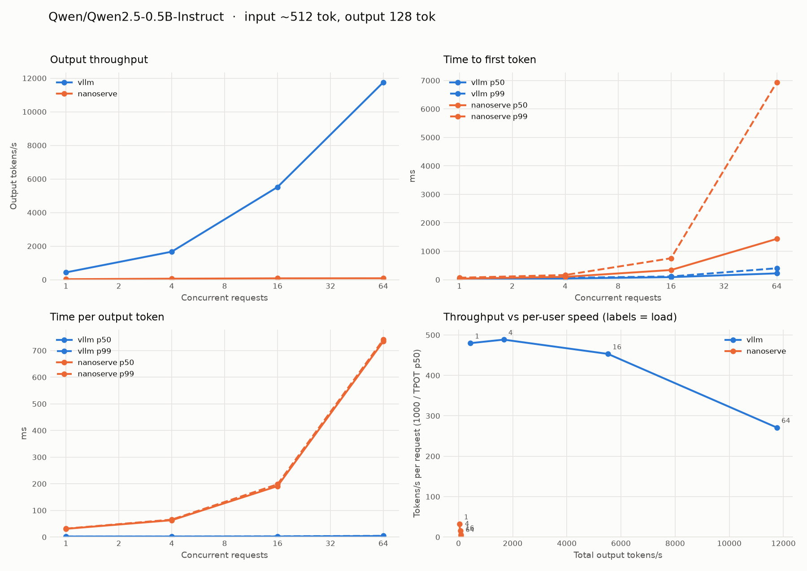
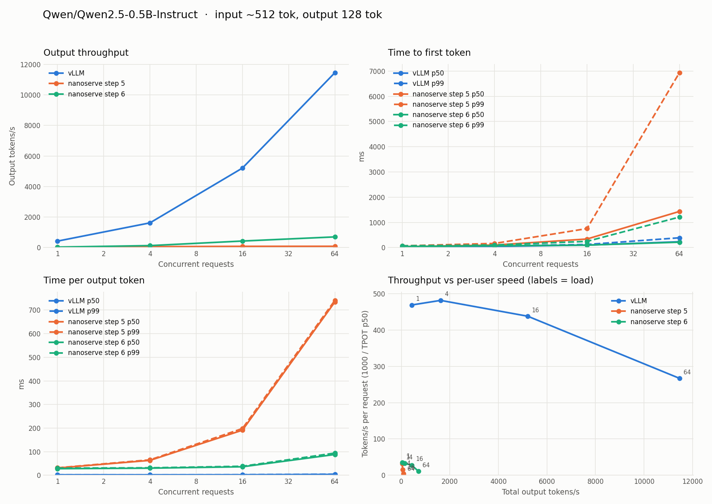
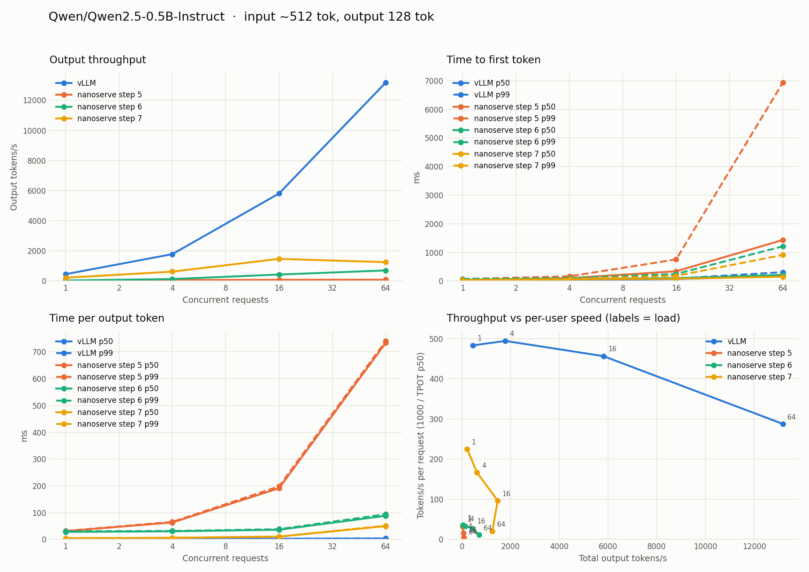

# nanoserve

A small LLM inference engine, built step by step to learn how vLLM works
inside. Each step is checked against the Hugging Face reference
implementation.

| Step | What | Status |
|---|---|---|
| 1 | Qwen2 written from scratch (GQA, RoPE, SwiGLU, RMSNorm), loading HF safetensors | ✅ |
| 2 | Paged KV cache: fixed-size blocks, block allocator, per-sequence block tables | ✅ |
| 3 | Continuous-batching scheduler: mixed prefill + decode, preemption when blocks run out | ✅ |
| 4 | OpenAI-compatible streaming server, measured with [`benchmarks/`](../benchmarks/README.md) | ✅ |
| 5 | Head-to-head with `vllm serve` on the same GPU, with a write-up of the gap | ✅ |
| 6 | Batched paged attention: one gather + one SDPA call per layer for the whole batch | ✅ |
| 7 | CUDA graphs for decode steps | ✅ |

## Design

- **Flat token batches.** The model takes `input_ids` and `positions` of shape
  `[num_tokens]`, not padded `[batch, seq_len]`. One forward pass can then mix
  prompt tokens from new requests with single decode tokens from running ones,
  which is what continuous batching needs.
- **Stateless model, pluggable attention.** The KV cache lives in an attention
  backend passed into `forward`. Step 1 uses `ContiguousKVCache` (one sequence,
  `max_len` slots reserved up front). Step 2 swaps in a paged backend without
  touching the model.
- **Logits only where needed.** `compute_logits` runs the LM head on just the
  rows being sampled. For a 1,000-token prompt that skips a `[1000, 151936]`
  matmul.
- **RoPE tables stay float32** when weights are cast to bf16/fp16, because
  low-precision cos/sin drift at long positions.

## Paged KV cache (step 2)

`paged_attention.py` splits KV memory into fixed-size blocks of `block_size`
tokens. Each sequence has a **block table** mapping its logical blocks to
physical ones. Token `p` lives in block `block_table[p // block_size]` at
offset `p % block_size`. Blocks are allocated as a sequence grows and freed
the moment it finishes.

Why it matters, in numbers for Qwen2.5-0.5B in bf16:
- **KV cache per token:** 2 (K and V) × 24 layers × 2 KV heads × 64 dims ×
  2 bytes = **12 KiB**.
- **Contiguous cache:** must reserve the full context for every sequence:
  32,768 tokens × 12 KiB = **384 MiB per sequence**, even for a 50-token
  reply.
- **Paged cache, 16-token blocks:** wastes at most 15 slots (180 KiB) per
  sequence.

That difference is how many sequences fit in the batch at once, and batch size
is where throughput comes from.

One forward pass can carry a mix of sequences, each adding any number of
tokens: a whole prompt (prefill) or one token (decode). `begin_step` takes
`(seq_id, num_new_tokens)` pairs, allocates the blocks, and returns token
positions plus a **slot mapping**: where each new token's K/V gets written.

`generate_batch` prefills all prompts in one pass, then decodes every running
sequence together, freeing blocks as sequences hit EOS. On an M-series CPU
with 8 prompts, it produces output identical to running them one at a time,
**3.1× faster** (97 vs 31 tok/s).

**Limitation (fixed in step 6):** attention originally gathered each
sequence's blocks into a contiguous tensor, then ran SDPA per sequence in a
Python loop. That's correct but slow. vLLM's PagedAttention kernel reads K/V
straight from the scattered blocks inside the kernel, for the whole batch at
once.

## Continuous batching (step 3)

`engine.py` has an `LLMEngine` that accepts requests at any time. Each
`step()` the scheduler builds a fresh batch under a token budget
(`max_num_batched_tokens`), in the same order as vLLM's V1 scheduler:

1. **Running requests first, oldest first.** A request still prefilling gets
   its next prompt chunk; a decoding request gets one token. If no KV block
   is free, the **newest** running request is **preempted**: its blocks are
   freed and it goes to the front of the waiting queue. When it's rescheduled,
   it recomputes its KV from prompt + output so far (vLLM's default
   "recompute" mode, rather than swapping to CPU).
2. **Then waiting requests**, first come first served, while the budget,
   `max_num_seqs` and free blocks allow. A prompt bigger than the remaining
   budget is split across steps (**chunked prefill**), so a 4,000-token
   prompt can't stall every running decode for a whole step.

A request samples a token only in a step where its scheduled tokens reach the
end of everything it knows: the last prompt chunk, or a decode step.

**Measured on the real model:** Qwen2.5-0.5B on an M-series CPU, 16 requests,
at most 8 running at once, output lengths mixed between 8 and 128 tokens:

| | Wall time | Useful tok/s | Mean TTFT |
|---|---|---|---|
| Static batching (groups of 8, each group runs to its longest request) | 12.7 s | 69 | ~5.1 s |
| Continuous batching (finished requests replaced immediately) | 9.8 s | 90 | 1.8 s |

The two give identical outputs. Static batching wastes decode slots on
requests that already finished, and makes new requests wait for the slowest
request in the group. The more uneven the output lengths, the bigger the gap.

**Tests** (`tests/test_nanoserve_engine.py`) put the scheduler under pressure
and require greedy output identical to one-request-at-a-time generation:
- a `max_num_seqs` cap, which leaves requests queued;
- a tiny token budget, which forces chunked prefill;
- a cache too small for the workload, which forces preemption and recompute;
- requests arriving mid-flight.

They also check invariants: the token budget is never exceeded, decodes keep
running while a long prompt is chunked in, every block is freed at the end,
and seeded sampling is reproducible.

## OpenAI-compatible server (step 4)

```bash
python -m nanoserve.server --model Qwen/Qwen2.5-0.5B-Instruct --port 8000 --kv-cache-gb 1
curl localhost:8000/v1/chat/completions -H 'Content-Type: application/json' \
  -d '{"messages": [{"role": "user", "content": "What is a KV cache?"}], "stream": true}'
```

`server.py` serves `/v1/completions` and `/v1/chat/completions`, streaming
(SSE) or not, plus `/v1/models`, `/health` and `/metrics`. The metrics endpoint
reports running/waiting requests, free blocks, preemptions and aborts.

- **Engine on its own thread.** A forward pass blocks, so it can't run on the
  asyncio event loop. HTTP handlers hand requests and aborts to the engine
  thread through a thread-safe inbox. The engine thread pushes each token
  back to the handler's `asyncio.Queue` with `call_soon_threadsafe`. Between
  steps it drains the inbox, so a new request joins the very next batch.
- **Client disconnects abort the request** and free its KV blocks right
  away, instead of generating tokens nobody will read.
- **Incremental detokenization** decodes the whole output and emits the new
  suffix, holding back a trailing U+FFFD until a multi-byte character is
  complete. Decoding token by token would garble emoji and CJK text.
- **`--kv-cache-gb`** sizes the paged cache the way vLLM's
  `--gpu-memory-utilization` does. 1 GB = 2,730 blocks of 16 tokens = 43,680
  tokens for Qwen2.5-0.5B in fp32.

**Benchmarked with [`benchmarks/serving_benchmark.py`](../benchmarks/README.md)**
on an M-series CPU, fp32, 256-token prompts, 64-token outputs. All 128
requests succeeded:


| Concurrency | Output tok/s | TTFT p50 | TPOT p50 |
|---|---|---|---|
| 1 | 27 | 198 ms | 34 ms |
| 4 | 51 | 683 ms | 71 ms |
| 8 | 75 | 1,282 ms | 87 ms |
| 16 | 99 | 1,810 ms | 136 ms |

Batching buys 3.6× throughput, and each user pays for it in per-token
latency. That's the central trade-off of LLM serving. On a CPU the decode
step is compute-bound, so TPOT grows almost linearly with batch size. On a
GPU, decode is memory-bandwidth-bound, so TPOT stays nearly flat until the
batch is large. That's why GPUs batch so well, and step 5 will show it.

## vLLM vs nanoserve on a GPU (step 5)

`benchmarks/compare_engines.sh` runs the whole comparison on one rented GPU:

1. It benchmarks `vllm serve`.
2. It benchmarks nanoserve with the same model, dtype, `max_num_seqs` and
   workload.
3. It profiles a nanoserve decode step.
4. It writes the plots, a side-by-side table and the logs to
   `benchmarks/results/gpu/`.

```bash
# On the GPU machine (any NVIDIA GPU with 16 GB+ and bf16: L4, A10G, A40, RTX 4090, A100...)
git clone https://github.com/Kunal-Chandarana/vLLMLearning.git && cd vLLMLearning
bash benchmarks/compare_engines.sh          # ~20-30 min
# copy benchmarks/results/gpu/ back, commit it
```

The script installs vLLM with `uv` into its own venv and runs
`vllm download-kernels`. Both matter on a stock PyTorch image: plain `pip`
spent 35 minutes backtracking around the preinstalled torch, and without
FlashInfer's prebuilt kernels vLLM 0.32 tries to compile its sampler at
startup and crashes when there's no `nvcc`.

### Results: RTX 4090, vLLM 0.32.0

Qwen2.5-0.5B-Instruct, bf16, 512-token prompts, 128-token outputs,
`max_num_seqs` 64. Every request succeeded on both engines. Raw data, logs and
the profile are in [`benchmarks/results/gpu/`](../benchmarks/results/gpu/).



| Concurrency | vLLM tok/s | nanoserve tok/s | vLLM faster by | TTFT p50 vLLM / nano | TPOT p50 vLLM / nano |
|---|---|---|---|---|---|
| 1 | 435 | 32 | 13× | 31 / 39 ms | 2.1 / 31 ms |
| 4 | 1,669 | 63 | 27× | 43 / 101 ms | 2.0 / 63 ms |
| 16 | 5,518 | 83 | 67× | 90 / 340 ms | 2.2 / 191 ms |
| 64 | 11,755 | 86 | 136× | 223 / 1,435 ms | 3.7 / 734 ms |

**Prefill is close; decode is not.** At concurrency 1, time to first token is
39 ms vs 31 ms. A 512-token prefill is a few big matmuls, and those keep the
GPU busy no matter who launches them. Decode is one token per sequence per
step, so it's thousands of tiny ops, and that's where nanoserve falls behind.

**vLLM scales with the batch; nanoserve doesn't.** vLLM's throughput grows 27×
from 1 to 64 concurrent requests while its TPOT barely moves (2.1 → 3.7 ms).
That's decode being memory-bandwidth-bound: reading the weights once serves
the whole batch. nanoserve flattens out at ~86 tok/s from 16 on, and its TPOT
grows in step with the batch (31 → 63 → 191 → 734 ms, about 11 ms per extra
sequence). That linear growth is the signature of serial per-sequence work.

**The profile says why.** `profile_step.py` on one decode step
([`nanoserve_profile.txt`](../benchmarks/results/gpu/nanoserve_profile.txt)):

| Batch | Step time | GPU busy | Kernel launches per step |
|---|---|---|---|
| 1 | 30.5 ms | 3.9 ms (13%) | ~1,770 |
| 16 | 192 ms | 26.5 ms (14%) | ~11,150 |

The GPU is idle **86% of the time**, waiting for Python. Each extra sequence
adds ~630 launches: 24 layers × the gather-blocks-then-SDPA loop in
`paged_attention.py`. Attention takes 89% of the CPU time at batch 16, the MLP
3%. The GPU work itself is small: 26.5 ms of real compute for 16 tokens is
already in the same range as vLLM's whole step at that batch size.

**So the gap is execution, not algorithms.** nanoserve has the same paged KV
cache, continuous batching and chunked prefill as vLLM. What it lacks, in
order of what the profile says would help most:

1. **A batched paged-attention kernel.** One launch per layer that reads K/V
   straight from the blocks for every sequence (vLLM's FlashAttention /
   PagedAttention backends) instead of a Python loop with a gather and an
   SDPA call per sequence. This removes the part of the cost that grows with
   the batch, and is the reason nanoserve stops scaling.
2. **CUDA graphs.** Even at batch 1, ~1,770 launches cost 30 ms of Python for
   4 ms of GPU work. vLLM captures the decode step once per batch size and
   replays it with a single launch.
3. **Fused kernels.** RMSNorm, RoPE, SiLU-and-mul and residual adds as single
   kernels: fewer launches and fewer round trips to GPU memory.
4. **GPU-side sampling and overlapped scheduling.** Smaller wins once 1–3 are
   done.

## Batched paged attention (step 6)

Fix #1 from the list above, in plain PyTorch. `begin_step` now builds the
attention metadata once per step: a padded block table `[B, max_blocks]`, a
mask, and where each token sits in the padded layout. All 24 layers reuse it.
Each layer then does **one gather and one SDPA call for the whole batch**,
instead of a block-table tensor, gather, two `repeat_interleave`s, a mask and
an SDPA call per sequence.

- **Decodes and prefills are batched separately.** Padding to the longest
  sequence in the batch is fine for decodes (1 query each), but padding a
  decode to the length of a 512-token prompt chunk would multiply its work by
  512.
- **GQA without copying K/V.** Query head `h` reads KV head `h // group`, so
  the `group` query heads per KV head are folded into the query-length
  dimension: `[B, kv_heads, max_new * group, d]`. SDPA then sees plain
  multi-head attention with `kv_heads` heads. This works on any torch version
  (SDPA's `enable_gqa` needs 2.5+).
- **Padding is masked.** Padded key slots point at block 0 and are masked out;
  padded query rows can see key 0 so they never softmax over nothing, and are
  dropped afterwards.

Decode step on an M-series CPU, fp32, ~256-token context (`profile_step.py`):

| Batch | Before | After | Speedup | Attention share of CPU time |
|---|---|---|---|---|
| 1 | ~35 ms | ~34 ms | — | 20% → 9% |
| 16 | 120 ms (133 tok/s) | 61 ms (261 tok/s) | 2.0× | 60% → 14% |
| 64 | 347 ms (185 tok/s) | 112 ms (572 tok/s) | 3.1× | 78% → 23% |

The work that grew with the batch is gone; what's left is mostly the MLP and
per-op launch overhead.

### On the GPU (RTX 4090, same setup as step 5)

Rerun of `benchmarks/compare_engines.sh` on the same card, driver and image.
vLLM came in within 3% of its step 5 numbers, so the runs are comparable.
Data in [`benchmarks/results/gpu-step6/`](../benchmarks/results/gpu-step6/).



| Concurrency | nanoserve step 5 | nanoserve step 6 | Gain | vLLM | Gap to vLLM, step 5 → 6 |
|---|---|---|---|---|---|
| 1 | 32 tok/s | 35 tok/s | 1.1× | 425 | 13× → 12× |
| 4 | 63 | 131 | 2.1× | 1,621 | 27× → 12× |
| 16 | 83 | 430 | **5.2×** | 5,211 | 67× → 12× |
| 64 | 86 | 702 | **8.1×** | 11,460 | 136× → 16× |

- **nanoserve now scales with the batch.** TPOT stays at 28–36 ms from 1 to 16
  concurrent requests (it was 31 → 191 ms), the same flat shape as vLLM's.
- **The gap to vLLM is now roughly constant, ~12×**, instead of growing with
  concurrency. Whatever is left costs the same per step regardless of batch
  size, which points at fixed per-step overhead, not attention.
- **TTFT at 16 and 64 is now on par with vLLM's** (99 vs 99 ms, 215 vs 233 ms).

The decode profile at batch 16
([`nanoserve_profile.txt`](../benchmarks/results/gpu-step6/nanoserve_profile.txt))
shows where that fixed cost is:

| | Step 5 | Step 6 |
|---|---|---|
| Step time | 192 ms | 33.5 ms |
| GPU busy | 26.5 ms (14%) | 5.7 ms (17%) |
| Kernel launches per step | ~11,150 | ~1,470 |
| Attention share of CPU time | 89% | 28% |

GPU work itself shrank 4.6×, since the per-sequence gathers and
`repeat_interleave` copies are gone. But the GPU is still idle 83% of the
step: ~1,470 launches, each issued from Python, cost far more than the 5.7 ms
of math they trigger. That's exactly what **CUDA graphs** remove (fix #2): capture
the decode step once per batch size and replay it with a single launch.

## CUDA graphs (step 7)

`cuda_graphs.py` records a decode step's ~1,450 kernels once and replays them
with one launch. A graph replays fixed shapes at fixed memory addresses, so,
as in vLLM:

- **Only pure-decode steps are graphed** (every sequence adds one token).
  Prefill steps run eagerly; their big matmuls keep the GPU busy anyway.
- **Shapes are bucketed.** The batch is padded up to 1, 2, 4, 8, 16, 24, ...
  (vLLM's capture sizes) and the block table up to a power of two, up to
  4,096 tokens of context. Longer contexts fall back to eager. Every graph is
  captured at startup, largest first, into one shared memory pool.
- **One host-to-device copy per step.** Token ids, positions, KV slots,
  context lengths and block tables are packed into one static buffer per
  graph; the attention mask is computed inside the graph.
- **Padded rows are harmless.** They write K/V to a scratch block the
  allocator never hands out, and attend to a single key, so they never
  produce NaNs. Their outputs are dropped.
- On by default on CUDA; `--enforce-eager` turns it off, as in vLLM.

**A bug worth knowing about.** The first GPU run hit a device-side "index out
of bounds" assert on the *second* replay. The mask, key-position and
row-index tensors a graph reads were referenced only by the warmup closure,
which got dropped after capture. Python freed them, the caching allocator gave
their memory to the next eager op (a prefill step), and the graph kept
reading the old addresses. **Anything a captured graph reads must stay alive
as long as the graph does.** The CPU tests couldn't see it (nothing is
captured there); `test_captured_graphs_match_eager_on_cuda` does, because it
runs eager steps after capture.

### Results: RTX 4090

Decode step, `profile_step.py`, ~512-token context
([`gpu-step7/profile_*.txt`](../benchmarks/results/gpu-step7/)):

| Batch | Eager | CUDA graphs | Speedup | GPU busy, eager → graphs |
|---|---|---|---|---|
| 1 | 24.3 ms | 4.6 ms | 5.3× | 17% → 95% |
| 16 | 26.8 ms | 9.3 ms | 2.9× | 19% → 68% |
| 64 | 61.0 ms | 41.9 ms | 1.5× | 45% → 64% |

Serving benchmark, same workload as steps 5 and 6. vLLM ran 5–12% faster on
this pod than on the earlier ones, so the gap is against this run's vLLM. Data
in [`benchmarks/results/gpu-step7/`](../benchmarks/results/gpu-step7/).



| Concurrency | nanoserve step 6 | nanoserve step 7 | Gain | vLLM | Gap to vLLM, step 5 → 6 → 7 |
|---|---|---|---|---|---|
| 1 | 35 tok/s | 215 | 6.1× | 454 | 13× → 12× → **2.1×** |
| 4 | 131 | 622 | 4.7× | 1,782 | 27× → 12× → **2.9×** |
| 16 | 430 | 1,471 | 3.4× | 5,811 | 67× → 12× → **4.0×** |
| 64 | 702 | 1,249 | 1.8× | 13,178 | 136× → 16× → **10.6×** |

- **At low concurrency nanoserve is now close to vLLM.** TPOT at concurrency 1
  is 4.4 ms vs vLLM's 2.1 ms (it was 28 ms). At batch 1 the GPU is busy 95% of
  the step, so what's left is the work itself, not overhead.
- **At concurrency 64 the bottleneck has moved to the GPU.** Throughput is
  lower at 64 than at 16, and a batch-64 step spends 27 ms of real GPU time.
  Most of it is the padded gather: every layer copies each sequence's KV
  blocks, padded to a power-of-two bucket, into one dense tensor before SDPA.
  vLLM's kernel reads K/V straight from the blocks, with no copy.

**Next:** a real paged-attention kernel (for example a Triton kernel, or
FlashAttention's / FlashInfer's paged APIs) that reads K/V from the block
table in place. That's what's left between nanoserve and vLLM at high
concurrency.

## Usage

```bash
pip install torch transformers safetensors huggingface_hub
python -m nanoserve.generate --chat --prompt "What is a KV cache?" --max-tokens 128
python -m nanoserve.generate --device mps --dtype float16   # Apple GPU
```

## Tests

```bash
pytest tests/test_nanoserve_model.py                          # tiny random model, no download
NANOSERVE_REAL_MODEL=1 pytest tests/test_nanoserve_model.py   # + Qwen2.5-0.5B-Instruct (~1 GB)
pytest tests/test_nanoserve_paged.py                          # paged cache vs contiguous, batching
pytest tests/test_nanoserve_engine.py                         # scheduler: chunking, preemption, arrivals
pytest tests/test_nanoserve_server.py                         # HTTP: streaming, batching, disconnects
```

The tests check prefill logits, prefill followed by token-by-token decode, and
greedy generation against `transformers`. For the real model, the full-sequence
logits match exactly in float32.

Two traps in comparing against `transformers.generate`:
- **Pass an `attention_mask`.** Qwen's pad token is its EOS token, so
  `transformers` can't infer the mask.
- **Set `repetition_penalty=1.0`.** The checkpoint's `generation_config.json`
  sets it to 1.1, which applies even under greedy decoding.
